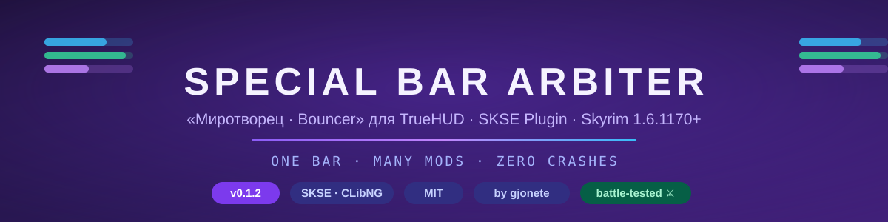

# Special Bar Arbiter (SBA) v0.1.2 — «Миротворец / Bouncer»

<p align="center">
  
</p>


Автор: **gjonete** — я люблю Skyrim с модами 🙂
SKSE-плагин, который прекращает войну комбо-модов за спец-полоски TrueHUD.

> 🇬🇧 English version: [README_EN.md](README_EN.md)

## Зачем он нужен

TrueHUD выдаёт управление «особой полоской» (стан/пауза над здоровьем)
только ОДНОМУ плагину — кто первый запросил, тот и хозяин. Из-за этого:
- ValhallaCombat, POISE, Chocolate Poise не могут сосуществовать;
- второй мод вызывает краш `std::bad_function_call` в TrueHUD.dll.

Arbiter перехватывает выдачу API (Microsoft Detours) и отдаёт полоски
только владельцу из конфига, остальным — вежливый отказ. Вызовы «мигнуть
полоской» без владельца безопасно игнорируются. Краш технически невозможен.

С v0.1.2 перехват встаёт **раньше всех**: сторожевой поток ловит момент
появления TrueHUD.dll в памяти — до первой раздачи `kPostLoad`. Даже моды,
получающие сообщения раньше нас в порядке загрузки, больше не могут взять
API в обход шима.

## 🏆 Проверено в бою (полевые отчёты)

Плагин прошёл живые испытания на реальной сборке (Wabbajack, 228 SKSE-плагинов):

- **Валгалла владеет полосками**: `RequestSpecialResourceBarsControl from
  'valhallaCombat' -> forwarded, result=0` — стабильно, сеанс за сеансом;
- **TDM вернулся**: `RequestTargetControl from 'TrueDirectionalMovement' ->
  OK forwarding` — цели-контроль работает из коробки;
- **Мирное соседство**: Chocolate Poise (poise-система) живёт рядом с
  Валгаллой без драки за полоски — каждому своё;
- **13+ минут непрерывного боя без единого краша** — там, где до установки
  SBA игра падала `std::bad_function_call`;
- **Расследование врага**: с помощью логов SBA был найден мод-конкурент,
  обходивший шим до v0.1.2 — и зафиксирован баг стороннего мода
  (Elden Parry), отправленный его авторам.

4 клиента пойманы и обслуживаются: TrueDirectionalMovement, valhallaCombat,
SkyParkourNG, BetterThirdPersonSelection.

## Установка (готовый DLL)

1. Скачайте `SpecialBarArbiter.dll` (сборка из Actions или Release).
2. В MO2 создайте мод-папку `SpecialBarArbiter`, внутрь положите:
   - `SKSE/Plugins/SpecialBarArbiter.dll`
   - `SKSE/Plugins/SpecialBarArbiter.ini`
3. Запустите игру.

Требования: SKSE, TrueHUD, игра 1.6.1170+ (NG-сборка совместима и с новее).

## Конфиг

`Data/SKSE/Plugins/SpecialBarArbiter.ini`:

```ini
[General]
; DLL-имя плагина-владельца спец-полосок (регистр не важен, .dll можно опустить)
SpecialBarOwner=ValhallaCombat
; 1 = подробный лог всех обращений к API (по умолчанию выключен)
VerboseLog=1

[TargetControl]
; DLL-имя владельца управления целью (True Directional Movement и т.п.)
; Пустое значение = прозрачный проход: любой мод получает control
TargetControlOwner=
```

Пустой `SpecialBarOwner` = прозрачный режим (никого не ограничивать).
Пробелы и табы по краям значений игнорируются, суффикс `.dll` можно писать
или не писать.

## Проверка работы

Лог: `Documents\My Games\Skyrim Special Edition\SKSE\SpecialBarArbiter.log`

- `Hook installed on TrueHUD.dll!RequestPluginAPI` — перехват активен;
- `RequestSpecialResourceBarsControl(...) from '...' -> forwarded, result=0`
  — владелец получил полоски;
- `RequestTargetControl(...) from 'TrueDirectionalMovement' -> OK forwarding`
  — TDM управляет целью;
- `RequestSpecialResourceBarsControl DENIED to '...'` — чужой мод получил
  вежливый отказ;
- `FlashActorValue swallowed ... crash prevented` — предотвращённый краш.

## Сборка из исходников

Репозиторий собирает себя сам: GitHub Actions → Build SpecialBarArbiter.
Артефакт: `SpecialBarArbiter.dll`. Детали — в `build.yml`.

## Лицензия

MIT — см. файл [LICENSE](LICENSE).
TrueHUD API © powerof3.
