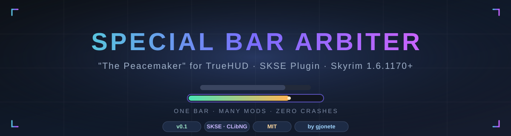

# Special Bar Arbiter (SBA) v0.1.2 — "The Peacemaker / Bouncer"

<p align="center">
  
</p>


Author: **gjonete** — I love Skyrim with mods 🙂
An SKSE plugin that ends the war between combat mods fighting over
TrueHUD's special bars.

> 🇷🇺 Русская версия: [README.md](README.md)

## Why it exists

TrueHUD grants control over the "special bar" (the stun/poise bar above
health) to exactly ONE plugin — first come, first served. As a result:
- ValhallaCombat, POISE, and Chocolate Poise cannot coexist;
- whichever mod loses the race triggers a `std::bad_function_call`
  crash inside TrueHUD.dll.

Arbiter intercepts API hand-out (Microsoft Detours) and grants the bars
only to the owner defined in the config; everyone else receives a polite
refusal. Unowned "flash the bar" calls are safely ignored. The crash
becomes technically impossible.

As of v0.1.2, the hook is installed **before everyone else**: a watcher
thread catches the moment TrueHUD.dll appears in memory — before the
first `kPostLoad` dispatch. Even mods that receive messages earlier in
the load order can no longer bypass the shim.

## 🏆 Battle-tested (field reports)

The plugin survived live testing on a real modlist (Wabbajack, 228
SKSE plugins):

- **Valhalla owns the bars**: `RequestSpecialResourceBarsControl from
  'valhallaCombat' -> forwarded, result=0` — session after session;
- **TDM is back**: `RequestTargetControl from 'TrueDirectionalMovement'
  -> OK forwarding` — target control works out of the box;
- **Peaceful coexistence**: Chocolate Poise (poise system) lives next to
  ValhallaCombat without fighting over the bars;
- **13+ minutes of continuous combat with zero crashes** — where the
  game used to die with `std::bad_function_call` before installing SBA;
- **Enemy investigation**: using SBA logs, a rival mod that bypassed the
  shim (pre-v0.1.2) was identified, and a third-party mod bug (Elden
  Parry) was documented and reported to its authors.

4 clients caught and served: TrueDirectionalMovement, valhallaCombat,
SkyParkourNG, BetterThirdPersonSelection.

## Installation (ready-made DLL)

1. Download `SpecialBarArbiter.dll` (from Actions or a Release).
2. In MO2, create a mod folder named `SpecialBarArbiter` and put inside:
   - `SKSE/Plugins/SpecialBarArbiter.dll`
   - `SKSE/Plugins/SpecialBarArbiter.ini`
3. Launch the game.

Requirements: SKSE, TrueHUD, game build 1.6.1170+ (the NG build is
forward-compatible).

## Configuration

`Data/SKSE/Plugins/SpecialBarArbiter.ini`:

```ini
[General]
; DLL name of the plugin allowed to own the special bars (case-insensitive,
; .dll suffix optional)
SpecialBarOwner=ValhallaCombat
; 1 = verbose log of every API request (off by default)
VerboseLog=1

[TargetControl]
; DLL name of the target-control owner (True Directional Movement etc.)
; Empty = transparent pass-through: any mod gets control
TargetControlOwner=
```

An empty `SpecialBarOwner` = transparent mode (no restrictions).
Leading/trailing spaces are ignored; the `.dll` suffix is optional.

## Verifying it works

Log file: `Documents\My Games\Skyrim Special Edition\SKSE\SpecialBarArbiter.log`

- `Hook installed on TrueHUD.dll!RequestPluginAPI` — the hook is active;
- `RequestSpecialResourceBarsControl(...) from '...' -> forwarded, result=0`
  — the owner received the bars;
- `RequestTargetControl(...) from 'TrueDirectionalMovement' -> OK forwarding`
  — TDM controls the target;
- `RequestSpecialResourceBarsControl DENIED to '...'` — a foreign mod was
  politely refused;
- `FlashActorValue swallowed ... crash prevented` — a prevented crash.

## Building from source

The repository builds itself: GitHub Actions → Build SpecialBarArbiter.
Artifact: `SpecialBarArbiter.dll`. Details are in `build.yml`.

## License

MIT — see [LICENSE](LICENSE).
TrueHUD API © powerof3.
